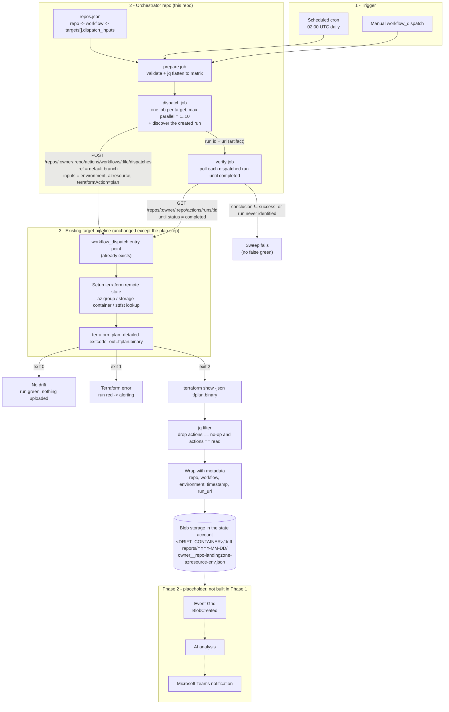
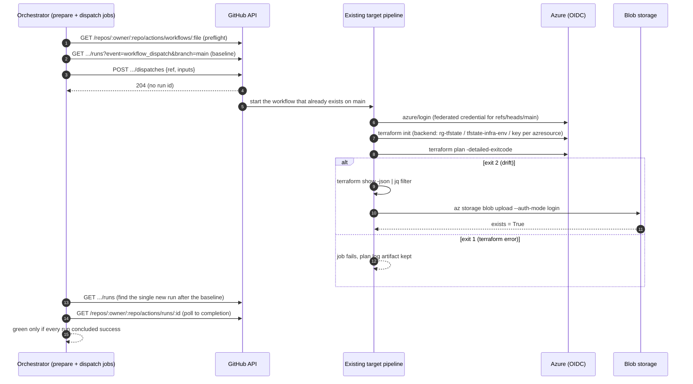

# Phase 1 architecture — automated Terraform drift detection

## End-to-end flow

## Dispatch and verification sequence

## Notes that shape the implementation

- **Nothing is installed in the target repositories.** The sweep calls the
  `workflow_dispatch` entry point that already exists, with the inputs that
  workflow already declares. That keeps one source of truth for how terraform
  runs in each repo (runner, SPN, backend, tfvars) and means there is no second
  pipeline that can drift from the real one.
- **The only target-side change is `-detailed-exitcode` plus the upload.**
  Without it a plan with changes exits `0`. The exit code is captured instead of
  failing the step, so drift stays green and only a terraform error turns the
  run red — run status keeps meaning "the pipeline worked".
- **Storage is reused, not created.** Reports go to a `drift-reports` container
  in the storage account the target already discovers (`sttfst`), created
  idempotently on first drift. No new app registration, no new secrets, no new
  role assignment; the plan step's existing OIDC session is reused for the
  upload. `azure/setup.sh` (dedicated account) is therefore optional.
- **`azresource` is the per-stack discriminator.** Each value has its own
  `ROOT_PATH=infra/<azresource>`, var-file and state key
  (`tfstate-infra-<azresource>`), so each is a separate drift target and gets
  its own report name. The 12 combinations are data in `repos.json`, not
  workflow variants.
- **Dispatch returns no run id, so runs are discovered and verified.**
  `workflow_dispatch` returns `204` with no body. With one target the sweep takes
  the single new `workflow_dispatch` run on the default branch after a
  pre-dispatch baseline; more than one candidate is a hard error
  (`Ambiguous dispatch`) rather than a guess. The `verify` job then polls every
  discovered run: any conclusion other than `success`, any run that cannot be
  identified, or any missing record fails the sweep.
- **Self-hosted runners are allowed for.** The target keeps
  `runs-on: [pda-self-hosted-linux]`; the orchestrator itself runs on
  `ubuntu-24.04` and only speaks to the GitHub API, so it needs no network path
  to Azure or to the private state storage.
- **`terraform fmt -check` runs before the plan** in the target pipeline. A
  formatting difference fails the job before plan executes and shows up as a
  failed run, not as drift — a real pipeline failure, surfaced as one.
- **Reports may contain secrets.** `terraform show -json` includes sensitive
  attribute values in plaintext. The container is private and reports should be
  treated as sensitive data.
