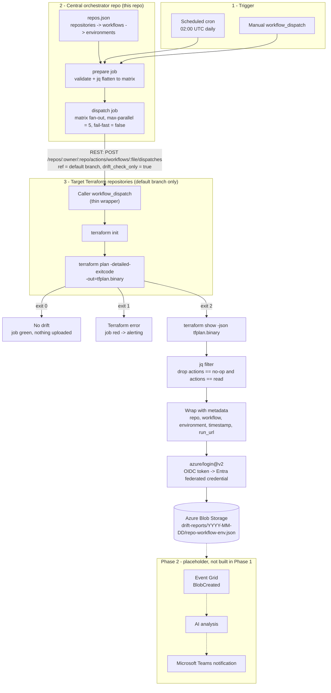
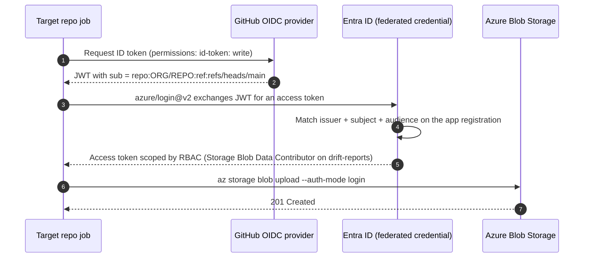

# Phase 1 architecture — automated Terraform drift detection

## End-to-end flow

## OIDC token exchange (why no storage keys are stored)

## Notes that shape the implementation

- **Reusable workflow, thin caller.** All target-side logic lives in
  `.github/workflows/reusable-drift-check.yml`; each Terraform repo holds a
  ~15-line `workflow_dispatch` caller (`examples/target-repo-caller.yml`). The
  orchestrator dispatches the *caller* file, because a reusable workflow cannot
  be dispatched directly.
- **One federated credential per target repo.** With a reusable workflow the
  OIDC `sub` claim identifies the *calling* repository, while
  `job_workflow_ref` identifies the shared workflow. Entra matches `sub` by
  default, so the trust is granted per repository/branch, not once centrally.
- **Immutable subject format.** Repositories created after 2026-07-15 use
  `repo:OWNER@OWNER_ID/REPO@REPO_ID:ref:refs/heads/BRANCH`. `azure/setup.sh`
  detects the format from `created_at`; with Terraform, set `subject` per entry.
  A mismatch fails closed with `AADSTS70021`.
- **Drift is not a failure.** Exit `2` uploads and stays green; only exit `1`
  (terraform error) turns the job red, so run status remains meaningful.
- **Dispatch is fire-and-forget.** `workflow_dispatch` returns `204` with no run
  id, so traceability comes from the target run writing its own `run_url` and
  the orchestrator run URL into the report metadata.
- **Reports may contain secrets.** `terraform show -json` includes sensitive
  attribute values in plaintext. The container is private, shared key access is
  disabled, and blobs expire after 90 days.
